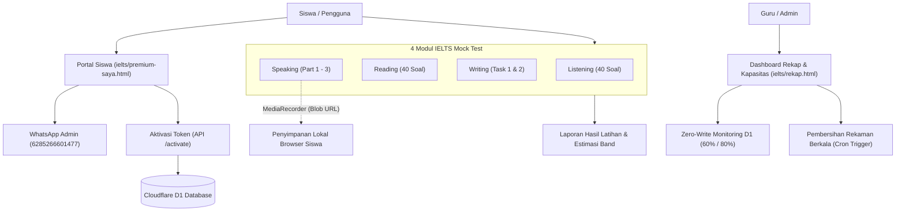

# LAPORAN PROGRESS & KESIAPAN FITUR PREMIUM IELTS ACADEMIC
## Platform AjarKita (https://kimia.ajarkita.my.id)
**Tanggal Pembaruan:** 4 November 2026  
**Status Keseluruhan:** 🟡 **Siap Uji Coba Terbatas (Limited Pilot / Beta Preview)**  
**Hasil Pengujian:** 184 Pengujian Otomatis Lulus (26 Test Suites, 100% Lulus, 0 Gagal)

---

### DAFTAR ISI
1. [Eksekutif & Integritas Sistem](#1-ringkasan-eksekutif--integritas-sistem)
2. [Detail Hasil Implementasi Tiap Tahap](#2-detail-hasil-implementasi-tiap-tahap)
   - [Tahap A: Optimalisasi Kapasitas & Rekaman Audio (A1–A5)](#tahap-a-optimalisasi-kapasitas--efisiensi-cloudflare-d1-free-tier)
   - [Tahap B: Lisensi, Kepatuhan Hukum, & Perlindungan Anti-Abuse (B1–B6)](#tahap-b-arsitektur-lisensi-kepatuhan-hukum--anti-abuse)
   - [Tahap C: Pengujian Menyeluruh & Audit Keamanan](#tahap-c-pengujian-menyeluruh--audit-keamanan)
3. [Alur End-to-End: Paket Mandiri vs Add-On Speaking](#3-alur-end-to-end-paket-mandiri-vs-add-on-speaking)
4. [Daftar Inventaris File (Dibuat & Dimodifikasi)](#4-daftar-inventaris-file)
5. [Panduan Operasional & Prosedur Admin](#5-panduan-operasional-admin)
6. [Konfigurasi Tarif & Layanan](#6-konfigurasi-tarif--layanan)
7. [Batasan Pengujian dan Uji Manual](#7-batasan-pengujian-dan-uji-manual)

---

### 1. RINGKASAN EKSEKUTIF & INTEGRITAS SISTEM

Fitur simulasi latihan mandiri **IELTS Academic Mock Test** di platform AjarKita saat ini berada pada status **Siap Uji Coba Terbatas (Limited Pilot / Beta Preview)**. Fondasi arsitektur, efisiensi kuota Cloudflare D1 Free Tier (Zero-Write), perlindungan anti-abuse, dan alur modul telah siap diuji coba pada kelompok pengguna terbatas, sembari menunggu penyelesaian pengujian manual perangkat nyata dan peninjauan draf dokumen hukum oleh praktisi yang kompeten sebelum rilis publik secara komersial. 



> [!IMPORTANT]
> **Status Integritas Fitur Lama:**  
> Fitur lama (SNBT dan Kimia): tidak ditemukan kegagalan pada pengujian otomatis. Verifikasi manual belum dilakukan.
> 
> Seluruh modul lama tetap dipreservasi:
> - Seluruh bank soal dan subtes UTBK-SNBT (Penalaran Umum, Pemahaman Bacaan, Pengetahuan Kuantitatif, Literasi Bahasa, Penalaran Matematika).
> - Sistem Try Out Akbar dan simulasi skor SNBT.
> - Program Voucher Beasiswa Mini-Game SNBT (Rp 35.000).
> - Modul Belajar Kimia Interaktif & Artikel Diskusi Sains Populer.

---

### 2. DETAIL HASIL IMPLEMENTASI TIAP TAHAP

#### Tahap A: Optimalisasi Kapasitas & Efisiensi Cloudflare D1 Free Tier
*Tujuan: Menjaga stabilitas kuota gratis Cloudflare D1 (500 MB storage per database, 100k writes/hari) dan privasi data siswa.*

- **A1 — Mesin Perekaman Audio Mandiri 100% Client-Side:**
  - Mengubah arsitektur perekaman di `ielts/speaking-engine.js` dan `ielts/speaking-mock-test.html` agar menggunakan `MediaRecorder` dan `URL.createObjectURL(blob)`.
  - Rekaman audio speaking siswa pada latihan mandiri **tidak diunggah ke server D1**, menghemat 100% kuota storage D1 untuk latihan mandiri.
  - Menambahkan tombol unduh audio per Part (Part 1, 2, 3) langsung di perangkat siswa.
  - Memasang banner transparan: *"Rekaman hanya tersimpan di perangkatmu dan akan hilang jika tab ditutup"*.

- **A2 — Manajemen Retensi & Cron Pembersihan Otomatis:**
  - Konfigurasi retensi terpusat di `worker/src/retention-config.js` (`CRON_SCHEDULE_UTC: "0 19 * * *"` = 02:00 WIB).
  - Penjadwalan harian di `worker/wrangler.jsonc`: `triggers.crons = ["0 19 * * *"]` (eksekusi pada pukul 19:00 UTC = 02:00 WIB dini hari saat beban server terendah).
  - Pembersihan otomatis: rekaman mandiri terhapus setelah 3 hari (sebagai jaring pengaman *defense-in-depth* untuk membersihkan data historis pengujian); rekaman penilaian guru terhapus 14 hari pasca-koreksi atau 60 hari jika belum dikoreksi.
  - **Sapu Bersih Universal:** Menjamin seluruh baris di `speaking_recordings` yang melewati retensi atau yatim (tanpa sesi) ikut dibersihkan tanpa kecuali.
  - **Preservasi Data:** Nilai angka, feedback teks, dan rekap skor guru tetap tersimpan di tabel database walau binary audio telah dibersihkan.
  - Pencatatan log pembersihan ke tabel `cleanup_logs`.

- **A3 — Penyimpanan Hardened SQLite BLOB Storage:**
  - Migrasi skema `speaking_recordings` ke tipe data murni `BLOB NOT NULL`.
  - Batas ukuran ketat maksimal **1 MB per audio** (HTTP 413 jika terlampaui).
  - Batas total akumulasi rekaman audio per sesi dibatasi maksimal **4 MB** (melindungi kapasitas D1 500 MB secara ketat).
  - Validasi ketat MIME audio whitelist (`audio/webm`, `audio/mp4`, `audio/ogg`, dll.) menolak file berbahaya (HTTP 415).
  - Dukungan streaming Safari iOS via **HTTP 206 Partial Content Range Requests** dan header `X-Content-Type-Options: nosniff`.
  - Token streaming HMAC berumur pendek maksimal **5 menit (300 detik)** untuk evaluasi audio oleh guru, terikat strictly ke satu `recording_id`.

- **A4 — Dashboard Zero-Write Capacity Monitoring:**
  - Visual panel pemantauan metrik Cloudflare D1 pada `ielts/rekap.html` (Storage MB, Row Count, Estimasi Writes/Hari).
  - Perhitungan berbasis metadata query **Zero-Write** tanpa menulis log ke database.
  - Persentase kapasitas storage dihitung secara presisi terhadap batas **500 MB per database** (`FREE_LIMIT_STORAGE_MB = 500`).
  - Indikator warna dinamis: Hijau (Normal < 60%), Kuning (Waspada 60% – 79.9%), Merah (Bahaya ≥ 80%).

- **A5 — Mode Hemat Server Otomatis (Eco-Mode) & Cadangan Darurat:**
  - Sistem otomatis beralih ke mode hemat jika penggunaan kapasitas mencapai 80%.
  - Interval autosave jawaban diatur secara hemat: **default 30 detik pada kondisi normal**, dan **60 detik pada Mode Hemat (80%)**.
  - Cadangan darurat lokal (`localStorage`) otomatis aktif pada setiap ketikan tombol keyboard (`input` event) sebagai proteksi instan jika browser crash atau jaringan terputus.
  - Menghalangi inisiasi attempt baru jika kuota 100% penuh via modal `#modal-quota-exceeded`.

---

#### Tahap B: Arsitektur Lisensi, Kepatuhan Hukum, & Anti-Abuse
*Tujuan: Memastikan legalitas merek dagang, kejelasan hak konsumen, pemisahan paket komersial, dan proteksi dari pembajakan lisensi.*

- **B1 — Rate Limiting & Audit Log Tanpa PII:**
  - Proteksi brute force token: maksimal 5 kali gagal per IP (kunci 15 menit), maksimal 10 kali salah per awalan token (kunci 30 menit).
  - Progressive delay bertingkat pada setiap percobaan gagal.
  - Penyamaran IP mentah: `ip_hash` dihitung menggunakan **HMAC-SHA256 dengan secret terpisah** (`env.IP_PEPPER`, tanpa fallback ke `ADMIN_KEY`).
  - Penyamaran awalan token: Awalan token 4 karakter dibutakan menggunakan **HMAC dengan salt terpisah** (`env.TOKEN_PREFIX_PEPPER`), menghasilkan format hash `pfx_<hex12>`.
  - **Laporan Temuan Penyimpanan Awalan Token:** Awalan token teks mentah (seperti `IELT-A8B9`) tidak lagi disimpan pada implementasi terbaru. Skema migrasi otomatis `ensureActivationSchema()` mengubah setiap entri historis lama menjadi `pfx_legacy_sanitized` dan membersihkan tabel `activation_attempts`. Dengan demikian, tidak ada awalan token mentah yang tersimpan dalam sistem audit.

- **B2 — Reset Perangkat Mandiri Guru & Pencabutan Token Real-Time:**
  - Endpoint aman `/admin/reset-devices` untuk mengosongkan riwayat perangkat siswa (maks. 2 perangkat) jika siswa berganti gadget.
  - Endpoint `/admin/revoke` dan `/admin/unrevoke` untuk mencabut atau memulihkan token bermasalah seketika.
  - Validasi token di backend Cloudflare Worker langsung menolak request dengan status HTTP 403 `token_revoked` atau `token_expired`.

- **B3 — Konfigurasi Paket Terpusat & Pemisahan Skema:**
  - Konfigurasi terpadu di `worker/src/packages-config.js` dan `ielts/packages-config.js`.
  - Kolom database `package_type = 'ielts'` vs `'snbt'` memastikan token IELTS tidak dapat membuka fitur SNBT dan sebaliknya.
  - Pembuatan portal siswa interaktif di [`ielts/premium-saya.html`](ielts/premium-saya.html) untuk memeriksa sisa hari aktif, ID perangkat terdaftar, dan melakukan aktivasi token.

- **B4 — Draf Dokumen Legal Indonesia & Checkbox Persetujuan Konsumen:**
  - Penyusunan 3 draf halaman hukum (bersifat draf internal, belum ditinjau praktisi hukum/advokat sebelum rilis publik):
    - [`kebijakan-privasi.html`](kebijakan-privasi.html)
    - [`syarat-ketentuan.html`](syarat-ketentuan.html)
    - [`kebijakan-refund.html`](kebijakan-refund.html)
  - Penambahan tautan hukum di footer global ([`partials/footer.html`](partials/footer.html)).
  - Penyediaan checkbox persetujuan wajib yang mencakup izin orang tua/wali bagi siswa di bawah 18 tahun.

- **B5 — Pembersihan Terminologi, Penegasan Non-Afiliasi, & Klarifikasi Add-On:**
  - Menghapus seluruh klaim berlebihan ("Band 8.0/8.5", "Kriteria Resmi", "Sertifikat", "Ujian Resmi") di 16 file modul IELTS.
  - Menggantinya dengan terminologi edukatif: *"Sample Answer"*, *"Rubrik 4 Kriteria Penilaian"*, *"Laporan Hasil Latihan"*, dan *"Estimasi Band"*.
  - Menempatkan **Disclaimer Non-Afiliasi Merek Dagang IELTS®** (Cambridge / British Council / IDP) secara prominen pada footer dan seluruh layar hasil tes.
  - Klarifikasi rincian tarif dan batasan layanan Add-on Koreksi Guru.

- **B6 — Tombol Beli & Pemesanan Add-On via WhatsApp Terpusat:**
  - Integrasi nomor admin resmi `6285266601477` secara dinamis dari `PACKAGES_CONFIG.admin_wa`.
  - Generator URL pesan pre-filled terformat untuk:
    - Pembelian Paket IELTS Mandiri 30 Hari (Rp 35.000).
    - Permohonan Bantuan / Reset Perangkat.
    - Pemesanan Add-on Koreksi 1 Esai (Rp 30.000).
    - Pemesanan Add-on Writing Lengkap (Rp 50.000).
    - Pemesanan Add-on Review Speaking (Rp 50.000).
  - Validasi persetujuan hukum: memblokir navigasi WhatsApp jika checkbox persetujuan belum dicentang.
  - Penempatan pil tombol `👑 Beli Token / Status Lisensi` pada hero section di keempat modul mock test.

---

#### Tahap C: Pengujian Menyeluruh & Audit Keamanan

Pemeriksaan keamanan dan ketahanan sistem (Security & Quality Assurance) dijalankan secara komprehensif menggunakan Node.js test runner bawaan:

| No | Modul Pengujian | Jumlah Test | Status |
|:---|:---|:---:|:---:|
| 1 | `tests/security-regression-audit.test.js` (XSS, CSV, MIME, Payload, Timing, Isolasi) | 6 | ✅ Lulus |
| 2 | `tests/whatsapp-buy-integration.test.js` (WA URL Generator, Dynamic Binding, Consent) | 3 | ✅ Lulus |
| 3 | `tests/terminology-sanitization.test.js` (Sample Answer, Disclaimer Non-Afiliasi) | 9 | ✅ Lulus |
| 4 | `tests/legal-and-consent.test.js` (UU PDP, UU ITE, Kebijakan Refund, Consent <18) | 5 | ✅ Lulus |
| 5 | `tests/package-config-and-separation.test.js` (Isolasi Skema IELTS vs SNBT) | 12 | ✅ Lulus |
| 6 | `tests/license-lifecycle-and-revocation.test.js` (Aktivasi, Reset Perangkat, Revoke) | 26 | ✅ Lulus |
| 7 | `tests/token-activation-ratelimit.test.js` (Lockout IP, Progressive Delay, Audit Log) | 7 | ✅ Lulus |
| 8 | `tests/speaking-hardened-storage.test.js` (BLOB, Range 206, MIME Whitelist, 1MB limit) | 10 | ✅ Lulus |
| 9 | `tests/speaking-local-recording.test.js` (MediaRecorder, Blob URL, Privacy Banner) | 7 | ✅ Lulus |
| 10 | `tests/speaking-retention-management.test.js` (Cron Retention, Preservasi Nilai Guru) | 9 | ✅ Lulus |
| 11 | `tests/capacity-monitoring.test.js` (Zero-Write Metrics, 60% Warning, 80% Danger) | 8 | ✅ Lulus |
| 12 | `tests/eco-mode-and-quota.test.js` (Autosave Throttle, Quota Exceeded Modal) | 8 | ✅ Lulus |
| 13 | `tests/band-rounding.test.js` (Algoritma Pembulatan Band IELTS & 4 Kriteria) | 23 | ✅ Lulus |
| 14 | `tests/csv-sanitization.test.js` (Netralisasi Formula Injection `=, +, -, @`) | 7 | ✅ Lulus |
| 15 | `tests/idor-device-defense.test.js` (Proteksi Pembajakan Perangkat & ID Siswa) | 7 | ✅ Lulus |
| 16 | `tests/atomic-submission.test.js` (Proteksi Submit Ganda & Nilai Guru) | 3 | ✅ Lulus |
| 17 | `tests/auth-security.test.js` (Timing Safe, Fail-Closed Teacher & Admin Key, Origin, Rate Limit) | 10 | ✅ Lulus |
| 18 | `tests/database-indexes.test.js` (Performa Query & Composite Indexes D1) | 2 | ✅ Lulus |
| 19 | `tests/array-dedup.test.js` (Pembersihan Opsi Ganda Soal Listening/Reading) | 6 | ✅ Lulus |
| 20 | `tests/late-submission-grace.test.js` (Grace Period Submit Ujian) | 1 | ✅ Lulus |
| 21 | `tests/pre-submit-privacy.test.js` (Privasi Transkrip & Audio Sebelum Submit) | 1 | ✅ Lulus |
| 22 | `tests/schema-cascade-delete.test.js` (Integritas Relasional SQLite D1) | 1 | ✅ Lulus |
| 23 | `tests/shared-device-id.test.js` (Format & Keunikan UUID Device) | 1 | ✅ Lulus |
| 24 | `tests/text-answer-normalization.test.js` (Normalisasi Jawaban Isian Singkat) | 5 | ✅ Lulus |
| 25 | `tests/step2-cron-hmac-audio-lockdown.test.js` (Cron UTC, HMAC IP Pepper, Server Lockdown 403, Universal Retention) | 6 | ✅ Lulus |
| 26 | `tests/concurrency-defense.test.js` (Audio Token <=5m, Delete-Customer Batch, Prefix HMAC, Concurrency Submit & Device Limit, Add-on Quota & 4MB limit) | 8 | ✅ Lulus |
| **TOTAL** | **26 Test Suites** | **184 Tests** | **✅ 100% PASS** |

---

### 3. ALUR KERJA END-TO-END: PAKET MANDIRI VS ADD-ON REVIEW SPEAKING

Untuk memahami arsitektur pemisahan hak akses dan perlindungan kuota Cloudflare D1 Free Tier (kapasitas 500 MB per database), sistem membedakan secara tegas alur kerja antara **Paket Mandiri** dan **Add-on Review Speaking oleh Guru**:

```mermaid
flowchart TD
    subgraph Mandiri ["Paket Mandiri (Rp 35.000 / 30 Hari)"]
        S1["Siswa Merekam Suara di Browser"] --> L1["MediaRecorder API (Blob URL)"]
        L1 --> L2["Penyimpanan Memori Lokal Perangkat"]
        L2 --> L3["Unduh Rekaman Lokal (.webm/.mp4)"]
        L1 -. "Coba Upload ke Server" .-> Block["POST /speaking/upload-recording"]
        Block --> Reject["HTTP 403 Forbidden (Server Lockdown)"]
    end

    subgraph Addon ["Layanan Add-On Review Guru (Rp 50.000)"]
        A1["Pesan Add-on via WhatsApp Admin"] --> A2["Admin Beri Hak Akses (package_type = 'addon')"]
        A2 --> A3["Siswa Merekam Suara Ujian"]
        A3 --> A4["Upload Audio Berhasil (POST /speaking/upload-recording)"]
        A4 --> D1Store[("Tabel speaking_recordings (BLOB D1, maks 1 MB)")]
        D1Store --> TeacherView["Guru Login di ielts/rekap.html (X-Teacher-Key)"]
        TeacherView --> Stream["Streaming Audio Terproteksi (HMAC Token 5 Mnt)"]
        Stream --> Grade["Guru Nilai 4 Kriteria: FC, LR, GRA, PR (POST /grade)"]
        Grade --> Result["Siswa Terima Nilai & Catatan di Portal (3-5 Hari)"]
        D1Store -. "14 Hari Pasca-Koreksi" .-> Cron["Cron Pembersihan Harian (0 19 * * * UTC)"]
        Cron --> Clean["Binary Audio Dikosongkan (X'') | Nilai & Catatan Guru Tetap Utuh"]
    end
```



#### A. Paket Mandiri (Zero-Write D1 Storage)
1. **Perekaman Lokal:** Siswa mengerjakan Speaking Part 1, 2, dan 3. Suara siswa direkam sepenuhnya di sisi browser menggunakan `MediaRecorder` API standar Web.
2. **Penyimpanan di Perangkat:** Berkas audio disimpan sementara sebagai `Blob URL` di memori browser lokal perangkat siswa. Siswa dapat mendengarkan kembali suaranya sendiri dan mengunduh berkas audio (`.webm` atau `.mp4`) ke perangkat masing-masing via tombol *"Unduh Rekaman"*.
3. **Tanpa Unggahan Server:** Sesuai desain penghematan kuota, rekaman siswa mandiri **tidak diunggah ke database server**.
4. **Proteksi Backend (HTTP 403):** Jika ada script atau permintaan liar yang mencoba memanggil endpoint `POST /speaking/upload-recording` atau `POST /speaking/upload-audio`, server memverifikasi `package_type` sesi (bernilai `'mandiri'` atau `'self_study'`) dan langsung menolak dengan status **HTTP 403 Forbidden**. Hal ini menjamin kuota database D1 100% aman dari beban ratusan siswa mandiri.
5. **Maksud Retensi Rekaman Mandiri 3 Hari:** Meskipun pada kondisi operasional normal paket mandiri menerapkan Zero-Write storage di sisi klien, konfigurasi sistem tetap menetapkan masa retensi 3 hari (`SELF_STUDY_RETENTION_DAYS: 3`). Ini dirancang sebagai jaring pengaman otomatis (*defense-in-depth*) untuk membersihkan baris audio uji coba developer, data pengujian historis, atau jika di masa depan fitur unggah diaktifkan sementara saat riset internal, sehingga baris mandiri yang tertinggal di server akan disapu bersih dalam 3 hari.

#### B. Layanan Add-On Review Speaking Guru
Jika siswa menginginkan evaluasi personal dari guru / pengajar:
1. **Pemesanan, Otorisasi, & Kuota Mingguan:** Siswa memesan Add-on Speaking via WhatsApp Admin (`PACKAGES_CONFIG.admin_wa`). Admin mengaktifkan hak Add-on pada lisensi siswa sehingga sesi speaking diterbitkan dengan status berhak unggah (`package_type = 'addon'`). Sistem secara otomatis menegakkan **kuota mingguan maksimal 20 sesi review per minggu** (dihitung sejak Senin 00:00 UTC) guna menjaga SLA koreksi 3–5 hari kerja.
2. **Perekaman & Batasan Volume Audio:** Pada sesi bertipe `'addon'`, antarmuka `ielts/speaking-mock-test.html` mendeteksi hak unggah aktif. Saat siswa menyelesaikan tiap pertanyaan (Part 1, 2, dan 3), berkas rekaman audio diunggah otomatis ke backend via `POST /speaking/upload-recording`:
   - Dibatasi maksimal **15 rekaman audio unik** per sesi ujian.
   - Ukuran maksimal **1 MB per berkas rekaman** audio (BLOB biner SQLite).
   - Batas total akumulasi audio maksimal **4 MB per sesi ujian** (HTTP 413 jika terlampaui). Berdasarkan data empiris, seluruh Part 1–3 umumnya hanya membutuhkan ~2.5 MB, sehingga batas 4 MB memberi margin aman sekaligus melindungi kapasitas storage D1.
3. **Pemeriksaan & Streaming Audio Terproteksi Guru:** Guru membuka dashboard rekap terpadu di [`ielts/rekap.html`](ielts/rekap.html) dengan otentikasi kunci guru (`X-Teacher-Key: $TEACHER_KEY`). Sesi siswa muncul dengan status `submitted`. Tombol audio meminta token sesaat via `POST /speaking/audio-token`. Server menerbitkan token HMAC berumur pendek maksimal **300 detik (5 menit)** yang terikat erat ke `recording_id`. Audio di-stream via Range 206 Safari dengan header privasi ketat: `Cache-Control: private, no-store, no-cache, must-revalidate` dan `Referrer-Policy: no-referrer`.
4. **Masa Simpan Nilai & Rekap Hasil:** Rekap nilai 4 kriteria (FC, LR, GRA, PR), overall band score, dan catatan umpan balik kualitatif guru tersimpan selama **12 bulan setelah masa aktif lisensi 30 hari berakhir**, atau **hingga ada permintaan penghapusan data resmi dari pengguna** (Hak Dilupakan UU PDP No. 27/2022), yang dicantumkan secara transparan di [Kebijakan Privasi](kebijakan-privasi.html). Berkas biner audio dibersihkan secara berkala oleh jadwal retensi, namun catatan dan rekap nilai tetap dipreservasi.
5. **Kebijakan Retensi Ganda Audio (Dual Retention):**
   - **Rekaman yang sudah dinilai:** berkas biner audio dibersihkan secara otomatis **14 hari pasca-koreksi** (`graded_at + 14d`).
   - **Rekaman yang belum/tidak dinilai:** berkas biner audio dibersihkan secara otomatis maksimal **60 hari sejak ujian dimulai** (`started_at + 60d`).
   - Eksekusi pembersihan dijalankan setiap hari oleh Cron Trigger Cloudflare Workers pada pukul `0 19 * * *` UTC (02:00 WIB dini hari).

---

### 4. DAFTAR INVENTARIS FILE

#### A. File Baru yang Dibuat
1. [`ielts/packages-config.js`](ielts/packages-config.js): Konfigurasi terpusat harga, durasi, fitur paket, batas 4 MB audio, dan generator URL WA frontend.
2. [`ielts/premium-saya.html`](ielts/premium-saya.html): Portal siswa untuk pemantauan masa aktif lisensi, ID perangkat, aktivasi token, dan pemesanan Add-on.
3. [`kebijakan-privasi.html`](kebijakan-privasi.html): Draf kebijakan privasi (memuat retensi 12 bulan nilai guru & 14 hari audio).
4. [`syarat-ketentuan.html`](syarat-ketentuan.html): Draf syarat dan ketentuan lisensi mandiri & layanan Add-on koreksi guru (belum ditinjau praktisi hukum).
5. [`kebijakan-refund.html`](kebijakan-refund.html): Draf kebijakan pengembalian dana berbasis status aktivasi kode lisensi (belum ditinjau praktisi hukum).
6. [`worker/src/retention-config.js`](worker/src/retention-config.js): Aturan batas masa simpan file audio rekaman (`CRON_SCHEDULE_UTC = "0 19 * * *"`).
7. [`worker/src/packages-config.js`](worker/src/packages-config.js): Modul konfigurasi paket, batas 4 MB audio, dan generator URL WA backend.
8. 26 Berkas Pengujian (184 unit tests passing) di folder [`tests/`](tests/) (termasuk `tests/concurrency-defense.test.js`).

#### B. File Utama yang Dimodifikasi
1. [`worker/src/index.js`](worker/src/index.js): Penambahan endpoint pembersihan retention cron UTC, HMAC IP pepper, server lockdown upload mandiri (HTTP 403), endpoint admin reset/revoke, BLOB audio range handler, batas 4 MB audio sesi, otorisasi terisolasi per paket, dan endpoint `delete-customer`.
2. [`worker/schema.sql`](worker/schema.sql): Skema tabel baru (`activation_attempts`, `activation_logs`, `cleanup_logs`) dan penambahan kolom `package_type` serta `revoked`.
3. [`ielts/rekap.html`](ielts/rekap.html): Dashboard pemantauan visual kapasitas D1 (basis 500 MB), sanitasi CSV injection, dan pembersihan audio manual.
4. [`ielts/writing-engine.js`](ielts/writing-engine.js): Autosave hemat default 30 detik (dan 60 detik saat Mode Hemat 80%), didukung backup instan lokal (`localStorage`) per ketikan.
5. [`ielts/reading-engine.js`](ielts/reading-engine.js): Autosave timer berkala diperpanjang ke 30 detik untuk penghematan kuota D1.
6. [`ielts/listening-engine.js`](ielts/listening-engine.js): Autosave timer berkala diperpanjang ke 30 detik untuk penghematan kuota D1.
7. [`ielts/speaking-engine.js`](ielts/speaking-engine.js): Mesin perekaman client-side berbasis Blob URL dan kontrol audio mandiri.
8. [`ielts/listening-mock-test.html`](ielts/listening-mock-test.html): Navigasi portal lisensi, sanitasi terminologi, dan disclaimer non-afiliasi.
9. [`ielts/reading-mock-test.html`](ielts/reading-mock-test.html): Navigasi portal lisensi, sanitasi terminologi, dan disclaimer non-afiliasi.
10. [`ielts/writing-mock-test.html`](ielts/writing-mock-test.html): Navigasi portal lisensi, sanitasi terminologi, dan disclaimer non-afiliasi.
11. [`ielts/speaking-mock-test.html`](ielts/speaking-mock-test.html): Navigasi portal lisensi, sanitasi terminologi, dan disclaimer non-afiliasi.
12. [`partials/footer.html`](partials/footer.html): Penambahan tautan dokumen legal dan disclaimer resmi.

---

### 5. PANDUAN OPERASIONAL ADMIN

#### A. Cara Menerbitkan Token Baru untuk Siswa (Generator Token Otomatis)
Ketika ada pembayaran terkonfirmasi via WhatsApp Admin:
1. **Jalur Resmi (Penerbitan via Endpoint API / Antarmuka Generator):**
   Kirim request ke API penerbitan token menggunakan variabel lingkungan `$ADMIN_KEY`:
   ```bash
   curl -X POST https://kimia-snbt-api.kimia-ajarkita.workers.dev/admin/token \
     -H "Content-Type: application/json" \
     -H "X-Admin-Key: $ADMIN_KEY" \
     -d '{"nama": "Nama Siswa", "wa": "0852xxxxxxxx", "packageType": "ielts", "days": 30, "maxDevices": 2}'
   ```
   **Prinsip Keamanan Generator Token:**
   - **Hash-Only Storage:** Server hanya menghitung dan menyimpan `token_hash = sha256Hex(token)` di database D1. Token teks asli tidak pernah disimpan di database.
   - **One-Time Display:** Token teks hanya dikembalikan sekali pada respons pembuatan. Antarmuka admin menampilkannya sekali dengan tombol salin teks pesan WhatsApp.
   - **Tanpa Pencatatan Token di Log:** Server tidak pernah mencatat token teks asli maupun awalan karakter aslinya di console log maupun `activation_logs`. Awalan token di-hash secara aman menggunakan HMAC (`pfx_<hex12>`) dan IP disamarkan dengan HMAC `IP_PEPPER`.

2. Kirimkan token teks kepada siswa untuk diaktifkan di [`ielts/premium-saya.html`](ielts/premium-saya.html).

> [!WARNING] **Jalur Darurat Saja (Disaster Recovery Only):**
> SQL INSERT manual di Cloudflare D1 Console hanya digunakan jika endpoint API mengalami gangguan total. Jangan digunakan pada operasional harian karena rawan salah hitung hash SHA-256 atau salah format parameter:
> ```sql
> INSERT INTO licenses (token_hash, nama, wa, package_type, created_at, duration_days, max_devices)
> VALUES ('<SHA-256_HASH_DARI_TOKEN>', 'Nama Siswa', '0852xxxxxxxx', 'ielts', strftime('%s','now')*1000, 30, 2);
> ```

#### B. Cara Reset Perangkat Siswa (Jika Ganti Gadget)
Jika siswa menerima pesan *"Batas 2 perangkat terlampaui"*:
1. Buka endpoint reset via POST ke API menggunakan `$ADMIN_KEY`:
   ```bash
   curl -X POST https://kimia-snbt-api.kimia-ajarkita.workers.dev/admin/reset-devices \
     -H "Content-Type: application/json" \
     -H "X-Admin-Key: $ADMIN_KEY" \
     -d '{"token": "IELT-XXXX-XXXX-XXXX"}'
   ```
2. Seluruh slot perangkat akan dikosongkan seketika sehingga siswa dapat login dari ponsel atau laptop barunya.

#### C. Prosedur Penghapusan Data Pembeli (Hak Dilupakan UU PDP No. 27/2022)
Jika siswa meminta penghapusan seluruh data pribadi (right to erasure/forgotten):
1. **Verifikasi Identitas Pemohon:** Cocokkan nomor WhatsApp, nama, dan bukti pembayaran pemohon untuk memastikan keabsahan hak.
2. **Pratinjau Data (Dry Run Default):**
   ```bash
   curl -X POST https://kimia-snbt-api.kimia-ajarkita.workers.dev/admin/delete-customer \
     -H "Content-Type: application/json" \
     -H "X-Admin-Key: $ADMIN_KEY" \
     -d '{"wa": "0852xxxxxxxx"}'
   ```
   Endpoint secara default berjalan dalam mode `dry_run`, menampilkan ringkasan data yang akan dihapus tanpa modifikasi database.
3. **Konfirmasi Penghapusan Atomik (Confirm):**
   ```bash
   curl -X POST https://kimia-snbt-api.kimia-ajarkita.workers.dev/admin/delete-customer \
     -H "Content-Type: application/json" \
     -H "X-Admin-Key: $ADMIN_KEY" \
     -d '{"wa": "0852xxxxxxxx", "confirm": true}'
   ```
   Server mengeksekusi batch deletion atomik kaskade (`licenses`, `devices`, `claims`, `speaking`, `writing`, `listening`, `reading`) dan mencatat ke `cleanup_logs` tanpa PII mentah.
4. **Data Transaksi yang Tetap Disimpan:**
   - Catatan mutasi rekening bank dan pembukuan kas akuntansi tanpa profil siswa tetap disimpan untuk memenuhi kewajiban hukum perpajakan (UU KUP — *perlu dikonfirmasi akuntan / konsultan pajak*).
5. **Pembersihan Salinan di Luar Sistem:**
   - Admin wajib menghapus riwayat percakapan WhatsApp bersama pemohon, bukti transfer di memori ponsel/komputer admin, serta rekaman spreadsheet ekspor jika ada.
6. **Catatan Retensi Cloudflare D1 Time Travel:**
   - Data aktif terhapus seketika dari database, namun snapshot historis internal *Cloudflare D1 Time Travel* masih tersimpan hingga 7 hari sebelum musnah secara fisik oleh Cloudflare.

#### D. Cara Memantau Kuota Database Cloudflare D1
1. Buka dashboard guru di [`ielts/rekap.html`](ielts/rekap.html).
2. Masukkan Kunci Guru (disimpan secara aman di Worker Secret `$TEACHER_KEY`).
3. Perhatikan widget **"Pemantauan Kapasitas Cloudflare D1 (Free Tier)"**:
   - Angka kapasitas storage dihitung terhadap batas **500 MB per database** (`FREE_LIMIT_STORAGE_MB = 500`).
   - Rumus persentase: `percent = Math.min(100, ((used_mb / 500) * 100).toFixed(1))`.
   - Jika status **Normal (Hijau < 60%)**: operasional berjalan tanpa hambatan.
   - Jika status **Waspada (Kuning 60% – 79.9%)**: pertimbangkan menjalankan pembersihan rekaman audio kadaluarsa via tombol *Pembersihan Audio*.
   - Jika status **Mode Hemat (Merah ≥ 80%)**: sistem secara otomatis memperpanjang jeda autosave untuk menghemat kuota tulis harian.

---

### 6. KONFIGURASI TARIF & LAYANAN

| Jenis Layanan | Komponen | Biaya / Durasi | Keterangan & Ketentuan |
|:---|:---|:---:|:---|
| **Paket IELTS Mandiri** | 4 Modul Latihan Lengkap (L, R, W, S) | **Rp 35.000** / 30 Hari | Akses penuh latihan mandiri, penilaian otomatis L/R, rubrik & sample answer W/S, maks. 2 gadget pribadi. Tanpa koreksi personal guru. |
| **Add-On Koreksi Guru** | Koreksi 1 Esai (Task 1 atau 2) | **Rp 30.000** | Umpan balik diagnostik 4 kriteria dengan estimasi band score. Selesai dalam 3–5 hari kerja. |
| **Add-On Koreksi Guru** | Koreksi Writing Lengkap (Task 1 + 2) | **Rp 50.000** | Umpan balik diagnostik 4 kriteria untuk kedua tugas writing. Selesai dalam 3–5 hari kerja. |
| **Add-On Koreksi Guru** | Review Speaking (Part 1–3) | **Rp 50.000** | Review rekaman audio performa lisan 3 bagian dengan umpan balik 4 kriteria, batas akumulasi 4 MB audio. Selesai dalam 3–5 hari kerja. |

> [!NOTE]
> Semua nomor kontak layanan WhatsApp terpusat diarahkan ke Admin Resmi AjarKita: **`+62 852-6660-1477`**.

---

### 7. BATASAN PENGUJIAN DAN UJI MANUAL

#### A. Batasan Pengujian Otomatis (Hal yang Tidak Dapat Diuji Otomatis)
Meskipun sistem telah lulus 184 pengujian unit dan integrasi otomatis secara komprehensif, terdapat aspek-aspek interaksi fisik, perangkat keras, dan lingkungan produksi yang **tidak dapat diverifikasi secara otomatis** dan mutlak membutuhkan uji manual di perangkat nyata:
1. **Perilaku Perangkat Keras & Izin Mikrofon Klien:**
   - Permintaan izin mikrofon (`getUserMedia`) pada browser mobile Safari iOS dan Chrome Android.
   - Penanganan interupsi hardware di dunia nyata (misalnya: panggilan telepon masuk, notifikasi WhatsApp bersuara, atau alarm berbunyi saat siswa sedang merekam suara).
2. **Variasi Codec Audio Perangkat Pengguna:**
   - Kompatibilitas container dan codec perekaman audio browser nyata (`audio/webm;codecs=opus` pada Android/Desktop vs `audio/mp4` pada iOS Safari).
3. **Deep-Linking Aplikasi Native Eksternal:**
   - Navigasi tombol pemesanan WhatsApp menuju aplikasi WhatsApp native pada perangkat Android dan iOS (verifikasi kelancaran pembukaan aplikasi tanpa terblokir popup blocker).
4. **Fluktuasi Jaringan Seluler Nyata:**
   - Perilaku unggahan audio pada jaringan seluler tidak stabil (sinyal Edge/3G berlatensi tinggi atau terputus di tengah pengunggahan) dan verifikasi mekanisme retry.
5. **Restorasi Point-in-Time Cloudflare D1 Time Travel:**
   - Uji pemulihan data menggunakan bookmark waktu D1 via CLI Cloudflare (`wrangler d1 time-travel restore`) **wajib dilakukan pada database salinan atau database preview terpisah, bukan pada database produksi aktual** (guna mencegah hilangnya data transaksi produksi yang lebih baru).

#### B. Matriks Rujukan Lembar Uji Manual (9 Bagian Asli, 80 Skenario Uji)
Seluruh pengujian manual terinci wajib mengacu pada lembar kerja terstandar:  
[`Lembar_Uji_Manual_IELTS-Style_Mock_Test_dan_Paket_Premium_AjarKita.pdf`](Lembar_Uji_Manual_IELTS-Style_Mock_Test_dan_Paket_Premium_AjarKita.pdf).

| Kode Bagian | Nama Bagian Lembar Uji | Cakupan Pengujian Manual | Jumlah Skenario | Target Lingkungan Uji |
|:---:|:---|:---|:---:|:---|
| **A** | **Pembelian dan lisensi** | Alur order WA, penerbitan token, aktivasi, batas 2 gadget, lockout gagal, reset perangkat mandiri, pencabutan token | 14 | Ponsel & Desktop |
| **B** | **Alur modul** | Listening (audio & 40 butir), Reading (timer & 3 passage), Writing (word count & layout), Speaking (rekam Part 1–3 & Blob URL) | 25 | Ponsel & Laptop |
| **C** | **Skor dan hasil** | Konversi raw score ke band score, pembulatan IELTS resmi (.25 ke .5, .75 ke 1.0), tampilan hasil tanpa klaim sertifikat | 5 | Multi-Browser |
| **D** | **Dashboard guru dan add-on** | Login Teacher Key, pemutaran streaming audio range 206 (Safari), form penilaian 4 kriteria, ekspor CSV aman, pembersihan audio | 10 | Desktop Pengajar |
| **E** | **Kondisi dunia nyata** | Izin mic ponsel, interupsi panggilan telepon saat rekam suara, jeda jaringan seluler, pemulihan crash via localStorage | 9 | Ponsel Nyata (iOS/Android) |
| **F** | **Keamanan dasar** | Server lockdown upload mandiri (HTTP 403), isolasi paket IELTS vs SNBT, sanitasi input XSS & formula injection CSV, fail-closed auth | 6 | DevTools & Postman |
| **G** | **Hukum dan konten** | Persetujuan izin wali (<18 thn), hak dilupakan (delete-customer dry run & batch), disclaimer non-afiliasi IELTS®, teks edukatif | 5 | Mobile & Desktop |
| **H** | **Regresi fitur lama** | Kelancaran kuis kimia interaktif SMA kelas 10–12, Try Out SNBT, dan validitas voucher reward mini-game beasiswa | 3 | Desktop & Mobile |
| **I** | **Cadangan dan pemulihan** | Ekspor cadangan SQL D1, uji pemulihan database di lingkungan preview terpisah, verifikasi keutuhan data pasca-restore | 3 | Terminal CLI & Cloudflare |
| **TOTAL** | **9 Bagian Lengkap** | **Matriks Uji Manual Komprehensif (Lembar Kerja Terstandar)** | **80 Uji** | **Multi-Platform (iOS, Android, Web)** |

---

#### C. Laporan Lingkungan Pengujian Konkurensi
1. **Pengujian Otomatis Node.js (8 Tes Konkurensi Lokal):**
   - Dijalankan menggunakan Node.js test runner bawaan dengan engine `node:sqlite` (`DatabaseSync`) sebagai replika in-memory dari basis data SQLite Cloudflare D1.
   - Menguji keandalan sintaks SQL atomik bersyarat:
     - `UPDATE sessions SET status = 'submitted' WHERE id = ? AND status = 'in_progress'` (tepat 1 submit berhasil dari 10 request paralel, 9 lainnya aman ditolak tanpa *race condition*).
     - `INSERT INTO devices ... WHERE (SELECT COUNT(*) FROM devices WHERE license_id = ?) < 2` (tepat 2 perangkat terdaftar dari 5 perangkat paralel, 3 lainnya aman ditolak).
2. **Pengujian Nyata di Lingkungan Cloudflare D1 Preview Asli (Remote):**
   - **Database Target:** `kimia-lisensi-preview` (Region: APAC / Singapore).
   - **Database UUID:** `2b9a6849-a29e-4906-a467-c41535ae4e09`.
   - **Konfigurasi `worker/wrangler.jsonc`:**
     `"preview_database_id": "2b9a6849-a29e-4906-a467-c41535ae4e09"`
   - **Waktu Eksekusi Pengujian:** 4 November 2026, 10:11:41 WIB (03:11:41 UTC).
   - **Perintah CLI yang Dijalankan:**
     ```bash
     node scratch/test_remote_d1_preview_concurrency.js
     # Yang mengeksekusi panggilan simultan (Promise.all paralel):
     npx wrangler d1 execute kimia-lisensi --remote --preview -y --command="..." --json
     ```
   - **Hasil Nyata Eksekusi D1 Preview:**
     - **Submit Paralel (5 Request Simultan - Conditional UPDATE):**
       - Req #1–4: `changes = 0, rows_written = 0` (Ditolak aman, durasi ~1370–1623ms)
       - Req #5: `changes = 1, rows_written = 3` (Berhasil diperbarui + pembaruan index, durasi 1353ms)
       - *Kesimpulan:* Tepat 1 request berhasil, 4 ditolak aman. Database D1 Preview bebas dari race condition submit ganda.
     - **Pendaftaran Perangkat Paralel (5 Request Simultan - Conditional INSERT `WHERE COUNT(*) < 2`):**
       - Dev #1–3: `changes = 0, rows_written = 0` (Ditolak aman, durasi ~1546–2797ms)
       - Dev #4–5: `changes = 1, rows_written = 2` (Berhasil terdaftar, durasi ~1263–1409ms)
       - *Verifikasi Database:* `SELECT COUNT(*) as total_dev FROM devices WHERE license_id = ...` menghasilkan tepat **2 perangkat**.
       - *Kesimpulan:* Batas `max_devices = 2` ditegakkan secara absolut di tingkat SQL engine D1 Cloudflare.
     - **Pembersihan Data Uji:** Baris uji di tabel `writing_sessions`, `devices`, dan `licenses` otomatis dibersihkan pasca-pengujian.

---

#### D. Laporan Rotasi Kunci Rahasia (Secret Key)
- Pengelolaan kunci rahasia Worker Secrets (`ADMIN_KEY`, `TEACHER_KEY`, `AUDIO_STREAM_SECRET`, `IP_PEPPER`, `TOKEN_PREFIX_PEPPER`) berada di Cloudflare Dashboard / `wrangler secret put` di bawah kewenangan penuh pemilik sistem.
- **Prosedur Verifikasi Pemilik Sistem:**
  1. Pemilik sistem mengganti nilai kunci lama di Cloudflare Dashboard.
  2. Lakukan uji coba pemanggilan API dengan kunci lama untuk memastikan penolakan:
     ```bash
     curl -s -o /dev/null -w "%{http_code}\n" -X GET https://kimia-snbt-api.kimia-ajarkita.workers.dev/guru/rekap -H "X-Teacher-Key: <KUNCI_LAMA>"
     # Respon WAJIB: 401 atau 403 (bukan 200)
     ```
  3. Pastikan kunci baru aktif dan berfungsi pada alur login dashboard.

---

#### E. Daftar Pemeriksaan Sebelum Soft Launch (Checklist Kesiapan)
Berikut adalah daftar pemeriksaan mandiri yang wajib diselesaikan sebelum membuka akses bagi kelompok perintis:
- [ ] **Rotasi Kunci:** Kunci rahasia lama diganti di Cloudflare Secrets dan diverifikasi telah ditolak (HTTP 401/403).
- [ ] **D1 Preview:** Tes konkurensi dan skrip inisialisasi diverifikasi pada D1 preview terpisah.
- [ ] **Uji Manual Kritis:** Skenario manual berkeparahan Kritis (K) lulus tanpa kendala terbuka (terutama Bagian A, B, D, dan F).
- [ ] **Cadangan & Pemulihan:** Cadangan database D1 berhasil diekspor (`wrangler d1 export`) dan uji pemulihan dipraktikkan pada database salinan/preview (bukan produksi).
- [ ] **Alur Pembayaran WhatsApp:** Tombol pemesanan WhatsApp diuji pada perangkat ponsel nyata dan prosedur verifikasi mutasi rekening dipraktikkan.
- [ ] **SOP Admin:** Seluruh alur administratif (penerbitan token, reset perangkat, pencabutan token, dan `delete-customer`) dipraktikkan minimal 1 kali.
- [ ] **Skala Pengguna Terbatas:** Soft launch dibatasi hanya untuk 10–20 pengguna yang dikenal, dengan pemantauan dasbor analitik Cloudflare Workers dan D1.
- [ ] **Tinjauan Dokumen Hukum:** Proses peninjauan dokumen hukum (kebijakan privasi, syarat ketentuan, kebijakan refund) oleh praktisi hukum yang kompeten resmi dimulai (wajib rampung sebelum peluncuran publik komersial terbuka).
